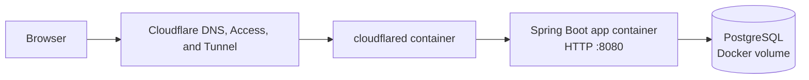
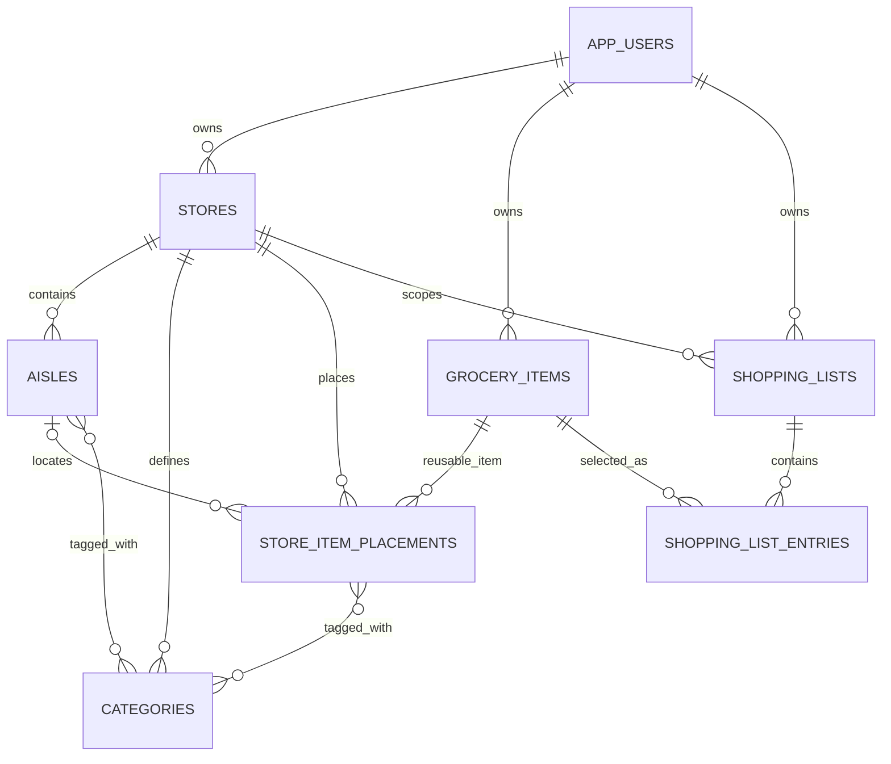

# Architecture

## Overview

This repository contains a small Spring Boot application and its local deployment stack. A static landing page lives at `/`. Market Day, the grocery-list application, is mounted at `/market`. The current UI is plain HTML, CSS, and JavaScript served by Spring Boot; the browser calls JSON endpoints on the same origin.

Cloudflare Tunnel is enabled with the Compose `tunnel` profile. Its token is read from `.env`; the remotely managed tunnel routes public hostnames to `http://app:8080` over the private Compose network. The app port is also bound to `127.0.0.1:8080` for local access and is not published on all host interfaces. Cloudflare Access is configured in Cloudflare and can restrict incoming requests before they reach the app.

## Application structure

- `HelloWorldApplication` starts Spring Boot and detects the one-shot admin CLI mode.
- `PageController` maps friendly paths such as `/market`, `/login`, `/register`, and `/admin` to static HTML files.
- `src/main/resources/static` contains the landing page, authentication pages, admin page, and Market Day interface. `app.js` loads the signed-in user's stores and calls the API; it keeps the selected store ID in browser local storage. The shopping map displays numbered item buttons; clicking a number optimistically updates every view and persists the checked state through the list-entry PATCH endpoint. `map-position.js` contains the pure positioning helpers used by the map and Node unit tests.
- `AuthController` handles registration, login, current identity, CSRF token retrieval, and logout.
- `StoreController` lists and creates stores belonging to the signed-in user.
- `GroceryController` implements store-scoped categories, aisles, catalog items, shopping lists, and list entries under `/api/stores/{storeId}/...`.
- `AdminController` lists accounts and approves registration requests. It is restricted to administrators.
- `AdminCliRunner` can create an initial administrator or promote an existing account without exposing a password on the command line.
- `StoreMigrationService` creates a default store for existing approved accounts and assigns older unscoped grocery records to a store.

## Authentication and authorization

Accounts use an individual email address and BCrypt password hash. Public registration creates an unapproved account; sign-in is blocked until an administrator approves it. The admin UI is at `/admin`.

Successful logins use a Spring Security session. Spring Session JDBC stores session data in PostgreSQL, allowing a login to survive an app restart. Sessions expire after 90 days of inactivity, and the session cookie is configured for a 90-day lifetime. Session IDs are rotated at login. State-changing requests require the CSRF token cookie and matching request header.

Authenticated store APIs check store ownership before reading or changing store-specific data; lists are additionally checked against their owner. The item catalog is shared globally among authenticated users, while aisle placement and categories are scoped to each store. Items can be added to any user's lists. Item deletion is limited to its creator and is blocked while any list uses it.

Admin bootstrap commands are described in [README.md](README.md). `grant-admin` both approves and promotes an existing account; `create-admin` prompts interactively for a new administrator password.

## Data model

PostgreSQL is the durable application database, stored in the named `postgres_data` Docker volume.

Each account can own multiple stores, and all accounts share one global item catalog. Item names are unique without regard to case across the catalog. `owner_id` records the creator for deletion authorization; it does not limit visibility or use. A `StoreItemPlacement` connects an item to a store and holds that store's optional aisle, aisle percentage, and item categories. Users can change an item's aisle placement from the catalog; the aisle selector includes each aisle's category names. Aisles use grid coordinates, a length, and orientation; the layout view expands to contain the furthest aisle extent. Aisles can be created, edited, and deleted. Aisle category entry autocompletes existing store categories and creates any newly entered names when the aisle is saved. Deleting an aisle leaves item placements intact and clears their aisle assignment; items in use by any shopping list cannot be deleted. List entries can refer to any shared catalog item and keep a quantity and checked state. The same checked state is reflected in the map, the “All list items” index, and the list view. Map number positioning is implemented in a DOM-independent helper and covered by isolated Node tests (`npm run test:map`); those unit tests do not measure browser-rendered pixel positions. Bulk item import adds names to the global catalog, one name per line, and does not import categories or store placements. Spring Data JPA/Hibernate updates application tables at startup (`spring.jpa.hibernate.ddl-auto=update`); startup copies existing store-bound item locations/categories into placements and clears the legacy store fields, retaining the old columns and join table. Spring Session JDBC tables use an idempotent PostgreSQL schema script at `src/main/resources/db/session-schema.sql`.

## Product and store-map standards

There is no single standard that supplies both a grocery taxonomy and a store-specific aisle layout. Keep Market Day's categories and aisle assignments editable and scoped to each store.

- [GS1 Global Product Classification (GPC)](https://www.gs1.org/standards/gpc/how-gpc-works) provides a global product hierarchy (segment, family, class, brick), including food categories. [GS1 Global Data Model (GDM)](https://www.gs1.org/services/gdsn/global-data-model) defines product attributes for retail data exchange. These can support optional external category mappings and richer product records; they do not define where an item is located in a particular store. A [GTIN](https://www.gs1.org/standards/id-keys/gtin) can identify a packaged trade item, but should remain optional because many generic, loose, or user-entered grocery items do not have a useful GTIN.
- [OGC Indoor Mapping Data Format (IMDF)](https://www.ogc.org/standards/indoor-mapping-data-format/) is a GeoJSON-based format for indoor venue maps. Its features include levels, spaces, and fixtures, which could represent store areas and physical equipment such as shelf runs. Consider it for future map import/export; it is more detailed and spatially grounded than Market Day's current aisle grid.
- [OGC IndoorGML](https://www.ogc.org/standards/indoorgml/) focuses on indoor spaces and their connectivity for navigation. It may be relevant if the app later models walkable paths or computes routes, but it is not needed for the current map and aisle-order shopping flow.

Treat any GPC classification or GTIN as an optional identifier alongside Market Day's own product identity, and any IMDF/IndoorGML representation as an interoperability layer. Neither replaces user-editable store-specific categories, aisle order, and item placement.

## Containers and configuration

`compose.yaml` defines three services:

- `db` runs PostgreSQL and persists its data in `postgres_data`.
- `app` builds the Spring Boot JAR with Maven and runs it as an unprivileged user. Its filesystem is read-only except for a temporary `/tmp` filesystem; Linux capabilities are dropped.
- `cloudflared` is optional and runs only with `--profile tunnel`.

Database credentials and the Cloudflare tunnel token belong in the untracked `.env` file. `.env.example` lists the required variables with placeholder values. Never commit `.env`.

Build the app image with `docker compose build app`. Run the application and database locally with `docker compose up -d`. Build and run with the Cloudflare Tunnel using `docker compose --profile tunnel up --build -d`. Check status with `docker compose --profile tunnel ps` and logs with `docker compose logs --tail=100 app db cloudflared`. The named PostgreSQL volume survives container recreation; Spring Session JDBC stores login sessions in PostgreSQL as well. `docker compose down -v` removes the database volume and all data.
