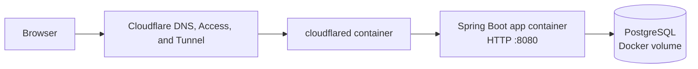
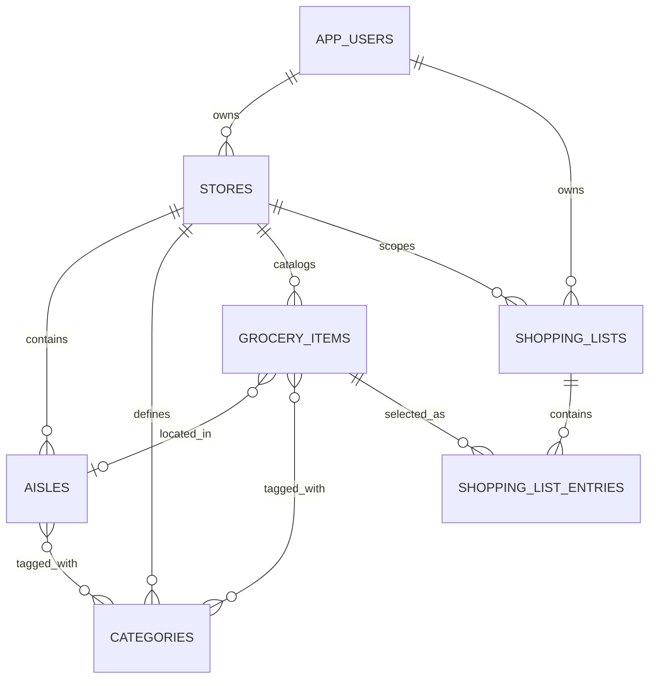

# Architecture

## Overview

This repository contains a small Spring Boot application and its local deployment stack. A static landing page lives at `/`. Market Day, the grocery-list application, is mounted at `/market`. The current UI is plain HTML, CSS, and JavaScript served by Spring Boot; the browser calls JSON endpoints on the same origin.

Cloudflare Tunnel is enabled with the Compose `tunnel` profile. Its token is read from `.env`; the remotely managed tunnel routes public hostnames to `http://app:8080` over the private Compose network. The app port is also bound to `127.0.0.1:8080` for local access and is not published on all host interfaces. Cloudflare Access is configured in Cloudflare and can restrict incoming requests before they reach the app.

## Application structure

- `HelloWorldApplication` starts Spring Boot and detects the one-shot admin CLI mode.
- `PageController` maps friendly paths such as `/market`, `/login`, `/register`, and `/admin` to static HTML files.
- `src/main/resources/static` contains the landing page, authentication pages, admin page, and Market Day interface. `app.js` loads the signed-in user's stores and calls the API; it keeps the selected store ID in browser local storage.
- `AuthController` handles registration, login, current identity, CSRF token retrieval, and logout.
- `StoreController` lists and creates stores belonging to the signed-in user.
- `GroceryController` implements store-scoped categories, aisles, catalog items, shopping lists, and list entries under `/api/stores/{storeId}/...`.
- `AdminController` lists accounts and approves registration requests. It is restricted to administrators.
- `AdminCliRunner` can create an initial administrator or promote an existing account without exposing a password on the command line.
- `StoreMigrationService` creates a default store for existing approved accounts and assigns older unscoped grocery records to a store.

## Authentication and authorization

Accounts use an individual email address and BCrypt password hash. Public registration creates an unapproved account; sign-in is blocked until an administrator approves it. The admin UI is at `/admin`.

Successful logins use a Spring Security session. Spring Session JDBC stores session data in PostgreSQL, allowing a login to survive an app restart. Sessions expire after 90 days of inactivity, and the session cookie is configured for a 90-day lifetime. Session IDs are rotated at login. State-changing requests require the CSRF token cookie and matching request header.

Authenticated API requests are scoped to the current account. Store IDs are checked against store ownership before reading or changing store data; lists are additionally checked against their owner. Items, aisles, and categories must belong to the same store when linked.

Admin bootstrap commands are described in [README.md](README.md). `grant-admin` both approves and promotes an existing account; `create-admin` prompts interactively for a new administrator password.

## Data model

PostgreSQL is the durable application database, stored in the named `postgres_data` Docker volume.

Each account can own multiple stores. A store has its own aisle layout, categories, item catalog, and shopping lists. Aisles use grid coordinates, a length, and orientation. Catalog items can reference an aisle and a percentage down that aisle. List entries refer to catalog items and keep a quantity and checked state. Spring Data JPA/Hibernate updates application tables at startup (`spring.jpa.hibernate.ddl-auto=update`); the Spring Session JDBC tables use an idempotent PostgreSQL schema script at `src/main/resources/db/session-schema.sql`.

## Containers and configuration

`compose.yaml` defines three services:

- `db` runs PostgreSQL and persists its data in `postgres_data`.
- `app` builds the Spring Boot JAR with Maven and runs it as an unprivileged user. Its filesystem is read-only except for a temporary `/tmp` filesystem; Linux capabilities are dropped.
- `cloudflared` is optional and runs only with `--profile tunnel`.

Database credentials and the Cloudflare tunnel token belong in the untracked `.env` file. `.env.example` lists the required variables with placeholder values. Never commit `.env`.

Run the application and database locally with `docker compose up --build -d`. Add the tunnel with `docker compose --profile tunnel up --build -d`. The named PostgreSQL volume survives container recreation; `docker compose down -v` removes the volume and its data.
